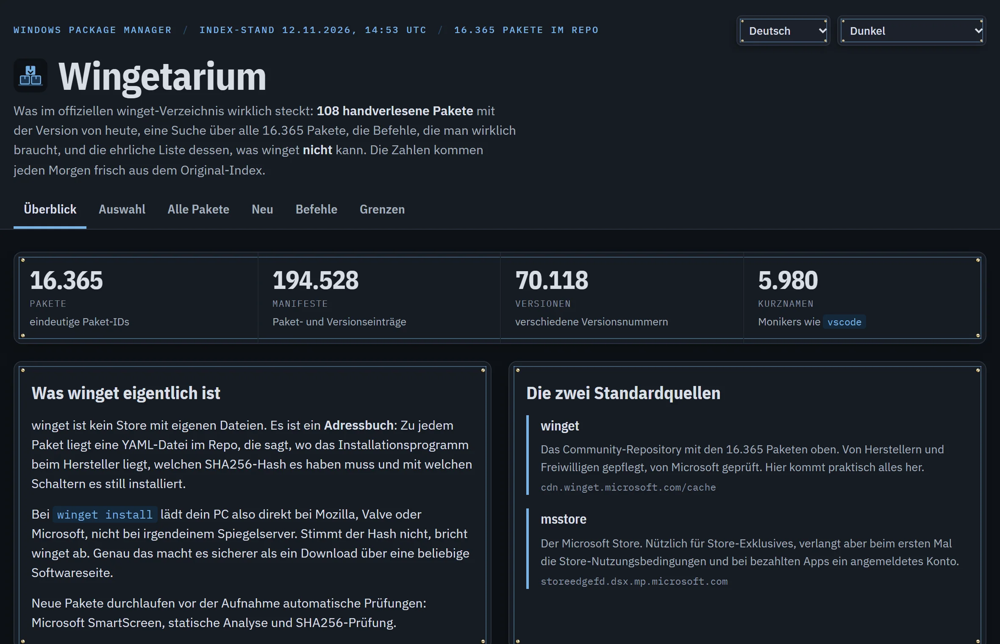

# Wingetarium

**Der winget-Katalog, täglich frisch.** Was im offiziellen Verzeichnis des Windows-Paketmanagers wirklich steckt: 108 handverlesene Pakete mit der Version von heute, eine Suche über alle Pakete, die Befehle, die man wirklich braucht, was seit gestern dazugekommen ist, und die ehrliche Liste dessen, was winget nicht kann. Ein GitHub-Workflow liest jeden Morgen den Original-Index, die Zahlen sind also nie älter als einen Tag.

  

**Live:** https://dennismit2n.github.io/wingetarium/ · [English version](README.md)



## Was es kann

| | |
|---|---|
| **Überblick** | Paketzahl, Manifeste, Versionen und Kurznamen aus dem Index von heute, die 20 häufigsten Schlagworte und eine Kurve, die jeden Morgen um einen Punkt wächst. |
| **Auswahl** | 108 Pakete in 15 Kategorien mit der Version von heute, den Kosten und wofür sie gut sind. Nach jeder Spalte sortieren, nach Kategorie filtern, suchen. Ein Klick auf die ID öffnet den Steckbrief. |
| **Alle Pakete** | Den kompletten Index (über 16.000 Pakete) nach Name, ID, Beschreibung oder Schlagwort durchsuchen, direkt im Browser. Wer nicht weiß, wonach er suchen soll, stöbert in 16 Themen oder den häufigsten Schlagworten. Ein Klick auf ein Paket öffnet den Steckbrief: was es ist, was es kann, Herausgeber, Lizenz, Webseite und `winget install --id … -e` zum Kopieren. |
| **Neu** | Jedes Paket, das seit dem Vortag dazugekommen ist, für die letzten 30 Tage. |
| **Befehle** | Die winget-Befehle, die man wirklich braucht, vom Finden bis zum Umzug auf einen neuen PC. Ein Klick kopiert. |
| **Grenzen** | Was winget nicht kann (Grafiktreiber, Spielebibliotheken, Schriften, Updates nach Zeitplan …), mit Zahlen aus dem Index von heute. |

## Wie die Daten herkommen

`tools/aktualisieren.py` lädt den offiziellen Quellindex von `cdn.winget.microsoft.com/cache/source.msix` (ein MSIX-Paket mit einer SQLite-Datenbank darin), nimmt von jedem Paket die neueste Version und schreibt `data/stand.json` und `data/index.json`. Der Workflow `.github/workflows/pages.yml` startet das jeden Morgen um 05:17 UTC, committet den neuen Stand als `wingetarium-bot` und veröffentlicht die Seite. Dein Browser spricht dabei nur mit dieser Seite, nie mit Microsoft.

Selbst ausführen:

```
python tools/aktualisieren.py
```

Die Auswahl steht in `data/auswahl.json` (ID, Kategorie, Kosten), die Texte dazu in `i18n/<sprache>.json`. Verschwindet eine ID aus dem Index, nennt die Seite sie unter der Tabelle, statt eine falsche Version zu zeigen.

## Datenschutz

- Kein Konto, keine Werbung, keine Cookies, kein Tracking, keine Schriften oder Skripte von fremden Seiten (IBM Plex liegt selbst gehostet bei, SIL Open Font License).
- Die Content Security Policy erlaubt Verbindungen nur zu dieser Seite (`connect-src 'self'`).
- Sprache und Darstellung landen nur dann im Browser, wenn du sie umstellst.

## Installieren und offline

Wingetarium ist eine PWA. Oben im Kopf gibt es den Knopf **Installieren** (Chrome, Edge, Android), auf dem iPhone geht es über Safari → Teilen → Zum Home-Bildschirm. Nach dem ersten Besuch startet es auch ohne Netz und zeigt den zuletzt geladenen Stand, mit Hinweis, wie alt er ist.

## Darstellung

System, Hell, Dunkel, Hoher Kontrast (dunkel und hell), Farbenblind (dunkel und hell) und Umgekehrte Farben. Die Wahl gilt für alle Werkzeuge auf dennismit2n.github.io.

## Kein Microsoft-Produkt

Wingetarium ist ein Hobbyprojekt und nicht von Microsoft. winget und die Paketdaten gehören ihren Eigentümern, die Paketliste stammt aus [microsoft/winget-pkgs](https://github.com/microsoft/winget-pkgs).

## Lizenz

MIT, siehe [LICENSE](LICENSE). Schriften: IBM Plex, SIL Open Font License 1.1, siehe [fonts/OFL.txt](fonts/OFL.txt).
