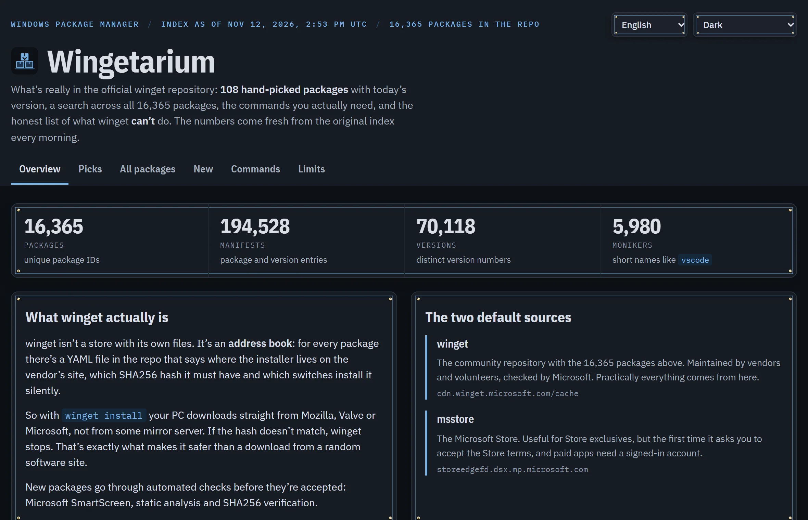

# Wingetarium

**The winget catalog, fresh every day.** What is really inside the official Windows Package Manager repository: 108 hand-picked packages with today’s version, a search across every package, the commands you actually need, what came in since yesterday and an honest list of what winget cannot do. A GitHub workflow reads the original index every morning, so the numbers are never older than a day.

  

**Live:** https://dennismit2n.github.io/wingetarium/ · [Deutsche Fassung](README.de.md)



## What it does

| | |
|---|---|
| **Overview** | Package count, manifests, versions and short names from today’s index, the 20 most common tags and a curve that grows by one point every morning. |
| **Hand-picked** | 108 packages in 15 categories with today’s version, what it costs and what it is good for. Sort by any column, filter by category, search. A click on the ID copies `winget install --id … -e`. |
| **All packages** | Search the complete index (more than 16,000 packages) by name, ID or short name, right in your browser. |
| **New** | Every package that appeared since the day before, for the last 30 days. |
| **Commands** | The winget commands you really need, grouped from finding to moving a whole PC. One click copies. |
| **Limits** | What winget cannot do (graphics drivers, game libraries, fonts, scheduled updates …), with numbers counted from today’s index. |

## How the data gets here

`tools/aktualisieren.py` downloads the official source index from `cdn.winget.microsoft.com/cache/source.msix` (an MSIX package with a SQLite database inside), picks the newest version of every package and writes `data/stand.json` and `data/index.json`. The workflow `.github/workflows/pages.yml` runs it every morning at 05:17 UTC, commits the new data as `wingetarium-bot` and publishes the site. Your browser only ever talks to this site, never to Microsoft.

Run it yourself:

```
python tools/aktualisieren.py
```

The hand-picked list lives in `data/auswahl.json` (ID, category, cost); the texts for it are in `i18n/<language>.json`. If an ID disappears from the index, the page lists it under the table instead of showing a wrong version.

## Privacy

- No account, no ads, no cookies, no tracking, no fonts or scripts from other sites (IBM Plex is self-hosted under the SIL Open Font License).
- The Content Security Policy allows connections only to this site (`connect-src 'self'`).
- Language and appearance are stored in your browser only when you change them.

## Install and offline

Wingetarium is a PWA. Use the **Install** button in the header (Chrome, Edge, Android) or, on iPhone, Safari → Share → Add to Home Screen. After the first visit it starts without a connection and shows the last data it saw, with a note saying how old it is.

## Appearance

System, light, dark, high contrast (dark and light), colour-blind (dark and light) and inverted colours. The choice is shared with the other tools on dennismit2n.github.io.

## Not affiliated

Wingetarium is a hobby project and not made by Microsoft. winget and the package data belong to their owners; the package list comes from [microsoft/winget-pkgs](https://github.com/microsoft/winget-pkgs).

## License

MIT, see [LICENSE](LICENSE). Fonts: IBM Plex, SIL Open Font License 1.1, see [fonts/OFL.txt](fonts/OFL.txt).
